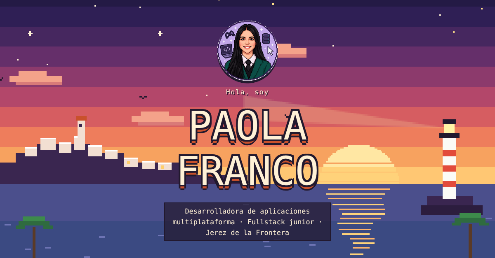

# El bosque de Paola · Portfolio interactivo



Portfolio de **Paola Franco**, desarrolladora de aplicaciones multiplataforma y fullstack junior en Jerez de la Frontera (Cádiz).

En lugar de una web de secciones, mi trayectoria se explora como un pequeño juego pixel-art. Recorres un pueblo rodeado de bosque y cada gimnasio guarda una parte de mi perfil (formación, stack, experiencia y proyectos). Al entrar en cada uno consigues una medalla. Si tienes prisa, el botón **Ver CV** lo muestra todo en una pantalla, y también puedes descargar el CV en PDF.

**Español / English:** la web es bilingüe. Añade `?lang=en` a la URL para abrirla en inglés.

## Funcionalidades

- **Mapa jugable** en Canvas 2D: movimiento con teclado (flechas / WASD) o con un toque en móvil.
- **Pathfinding A\*** con cola de prioridad (heap binario) programada a mano: el personaje calcula la ruta hasta el edificio que pulses.
- **Modo desarrollador** (`F2`): muestra la rejilla, las colisiones, los nodos explorados por A\*, la ruta y los FPS.
- **Terminal** con comandos (`help`, `ls`, `goto taller`, `stack`, `contacto`, `luz noche`, `lang en`…), historial y autocompletado con Tab.
- **Animales con IA sencilla** que deambulan, esquivan obstáculos y reaccionan al hacer clic.
- **Iluminación según la hora real de Madrid** (día, atardecer y noche, con ventanas y farolas encendidas).
- **Sistema de medallas** y popup final al completarlas.
- **Bilingüe ES/EN** sin recargar la página, recordando el idioma elegido.
- **Accesible**: navegable con teclado, diálogos nativos (`<dialog>`) y respeto a `prefers-reduced-motion`.
- **SEO**: datos estructurados JSON-LD, Open Graph y HTML semántico.

## Tecnología

- HTML, CSS y **JavaScript sin librerías ni frameworks**, en un único archivo.
- Canvas 2D con bucle de juego sobre `requestAnimationFrame` y *delta time*.
- Gráficos pixel-art dibujados por código, sin imágenes de sprites.
- Despliegue en **Netlify**.

## Estructura

```
index.html               La web completa (HTML, CSS y JS)
cv-paola-franco-es.pdf   CV en español
cv-paola-franco-en.pdf   CV en inglés
og-image.png             Imagen de vista previa para redes sociales
```

## Verlo en local

No necesita instalación. Abre `index.html` en el navegador, o sírvelo con cualquier servidor estático:

```bash
npx serve .
```

## Contacto

- Email: paolafg15@hotmail.com
- LinkedIn: [paola-franco-142638298](https://www.linkedin.com/in/paola-franco-142638298/)
- GitHub: [paolafranco0123](https://github.com/paolafranco0123)
